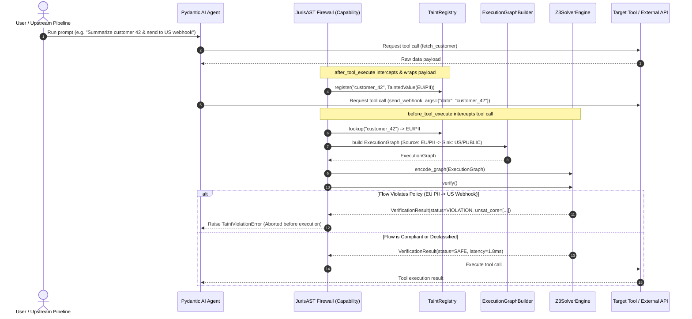

# JurisAST — System Architecture & Design

> **Formally Verified Information Flow Control for Multi-Agent Systems via Neuro-Symbolic Execution Firewalls**

---

## 1. System Overview & The Neuro-Symbolic Paradigm

Modern multi-agent architectures rely on Large Language Models (LLMs) to reason, decompose tasks, and invoke external tools (APIs, databases, webhooks). However, LLMs suffer from a fundamental architectural flaw: **Context Collapse**. In an LLM's flat attention context, executable code and untrusted retrieved text are represented identically as token embeddings.

Traditional security measures fail in this paradigm:
- **Role-Based Access Control (RBAC)** secures data at rest, but cannot prevent an authorized agent from forwarding retrieved private data to an unauthorized external sink under prompt injection.
- **Neural Guardrails (LLM-as-a-Judge)** introduce 200–2000ms latency per step, hallucinate, and fail under multi-step semantic obfuscation.

**JurisAST** introduces a **Neuro-Symbolic Execution Firewall** that decouples probabilistic reasoning from deterministic verification. The LLM is permitted to reason and plan freely; before any planned tool execution is submitted to the operating system or network, the intent is intercepted, transformed into a formal Abstract Syntax Tree (AST), and mathematically verified by a Microsoft Z3 SMT solver against formal Information Flow Control (IFC) lattice policies in under 5 milliseconds.

```
┌─────────────────────────────────────────────────────────────────────────────┐
│                             PROBABILISTIC ZONE                              │
│                                                                             │
│   ┌──────────────────┐    Planning & Tool Call     ┌────────────────────┐   │
│   │ Multi-Agent Swarm│ ──────────────────────────> │   Pydantic AI /    │   │
│   │ (LLM Planners)   │                             │ Structured Schema  │   │
│   └──────────────────┘                             └─────────┬──────────┘   │
└──────────────────────────────────────────────────────────────┼──────────────┘
                                                               │ Intercept
═══════════════════════════════════════════════════════════════╪═══════════════
                    JURISAST NEURO-SYMBOLIC FIREWALL           │ (<5ms)
═══════════════════════════════════════════════════════════════╪═══════════════
┌──────────────────────────────────────────────────────────────┼──────────────┐
│                             DETERMINISTIC ZONE               │              │
│                                                              ▼              │
│   ┌─────────────────────────────────────────────────────────────────────┐   │
│   │                   AST Extraction & Taint Tracking                   │   │
│   │   - Resolves data provenance from TaintRegistry                     │   │
│   │   - Constructs typed ExecutionGraph DAG                             │   │
│   │   - Enforces Shannon information bounds on DeclassifyNodes          │   │
│   └──────────────────────────────────┬──────────────────────────────────┘   │
│                                      │ Topological IR                       │
│                                      ▼                                      │
│   ┌─────────────────────────────────────────────────────────────────────┐   │
│   │                  Z3 SMT Theorem Prover Engine                       │   │
│   │   - Compiles graph nodes to first-order logic formulas              │   │
│   │   - Encodes data sovereignty lattice constraints                    │   │
│   │   - Evaluates: check(*assumptions) -> SAT / UNSAT                   │   │
│   └──────────────────────────────────┬──────────────────────────────────┘   │
│                                      │                                      │
│                ┌─────────────────────┴─────────────────────┐                │
│                ▼                                           ▼                │
│       [Result == SAT (SAFE)]                   [Result == UNSAT (VIOLATION)]│
│                │                                           │                │
│                ▼                                           ▼                │
│   ┌──────────────────────────┐                ┌─────────────────────────┐   │
│   │ OS / External API Sink   │                │ Abort Call & Raise      │   │
│   │ (HTTP, Database, AWS)    │                │ TaintViolationError     │   │
│   └──────────────────────────┘                │ (Unsat Core Attributed) │   │
│                                               └─────────────────────────┘   │
└─────────────────────────────────────────────────────────────────────────────┘
```

---

## 2. The Three Architectural Pillars

### Pillar A: Pydantic-Driven AST Taint Propagation
Data provenance is decoupled from LLM prompt context:
- When sensitive data is retrieved, it is wrapped in an immutable `TaintedValue[T]` container bearing a `SecurityLabel`.
- As data moves across tools and agents, transformations compute the **Least Upper Bound (Join)** of input labels.
- When an agent initiates a tool call, Pydantic parses arguments and the `ToolCallExtractor` maps the runtime references into an `ExecutionGraph` composed of typed `ASTNode` instances.

### Pillar B: Latency-Free Non-Interference Proofs (Z3 SMT Solver)
Deterministic verification replaces probabilistic guessing:
- The `ExecutionGraph` is converted into first-order logic formulas within the `Z3SolverEngine`.
- Sinks are gated by Boolean assumptions representing non-interference invariants:
  $$\forall s \in \text{Inputs}(sink), \quad (\text{Jurisdiction}(s) \le \text{TargetJurisdiction}) \land (\text{Classification}(s) \le \text{MaxClassification})$$
- The solver checks validity in `< 5ms`.
- If unsatisfied (`UNSAT`), Z3 extracts the minimal **Unsat Core**, identifying the exact source-to-sink route violating regulatory policy.

### Pillar C: Symbolic Declassification via Constrained Decoding
To enable legitimate business operations on tainted data without opening exfiltration channels:
- Agents downgrade data through a designated `DeclassifyNode`.
- The output is structurally constrained using Pydantic's strict type validation (`bool`, `Enum`, `Literal`).
- Shannon Mutual Information transferred is bounded by $I(X; Y) \le \log_2(|\mathcal{Y}|)$.
- The Z3 solver recognizes certified declassifier nodes as legitimate label transformations.

---

## 3. Core Component Architecture

```
libs/
├── jurisast-core/
│   ├── labels.py        ─── Multi-dimensional Security Lattice (Jurisdiction x Classification x Compartments)
│   ├── taint.py         ─── Generic TaintedValue[T], ProvenanceRecord audit trail, TaintRegistry
│   ├── ast_ir.py        ─── Discriminated union ASTNode hierarchy, ExecutionGraph DAG, ExecutionGraphBuilder
│   ├── solver.py        ─── Z3 SMT solver interface, incremental assumption solving, unsat core extraction
│   ├── policies.py      ─── Regulatory Policy Engine (FlowConstraint, PolicySet, Z3 compilation)
│   ├── declassifier.py  ─── Symbolic Declassification Engine (Shannon entropy bounds, strict validation)
│   ├── exceptions.py    ─── Structured exception hierarchy (TaintViolationError, ASTConstructionError, etc.)
│   └── config.py       ─── Central engine configuration (SolverConfig, AuditConfig, JurisASTConfig)
├── jurisast-policies/
│   ├── gdpr.py          ─── GDPR Chapter V cross-border transfer constraints (GDPR_DATA_SOVEREIGNTY)
│   ├── eu_ai_act.py     ─── EU AI Act high-risk biometric & automated scoring controls (EU_AI_ACT_COMPLIANCE)
│   ├── pci_dss.py       ─── PCI-DSS v4.0 cardholder data environment isolation (PCI_DSS_COMPLIANCE)
│   └── custom.py        ─── Fluent PolicyBuilder API for custom regulatory sets
└── jurisast-pydantic/
    ├── capability.py    ─── JurisASTFirewall capability intercepting before/after tool execution
    ├── decorators.py    ─── @tainted_source, @tainted_sink, @declassifier tool annotations
    ├── extractors.py    ─── ToolCallExtractor parsing Pydantic AI calls into AST ExecutionGraph fragments
    ├── tainted_context.py ─ RunContext integration and JurisASTDeps injection
    └── agent.py         ─── create_jurisast_deps() factory and model alias registry

examples/
├── README.md                  ─── Before vs. After JurisAST, quick-start commands
├── enterprise_ma_agent/
│   ├── app.py                 ─── Demo 1: M&A agent, prompt-injection attack, declassification
│   └── README.md              ─── Samsung/JPMorgan context, code comparison
└── fintech_support_agent/
    ├── app.py                 ─── Demo 2: GDPR-compliant EU→US flow via error-code declassification
    └── README.md              ─── Meta €1.2B fine context, information flow diagram
```

### Component Interaction Sequence



---

## 4. Mathematical Model: Product Lattice Formulation

JurisAST models information security labels as an algebraic product lattice $\mathcal{L} = \mathcal{J} \times \mathcal{C} \times \mathcal{P}(\mathcal{K})$, where:

1. **$\mathcal{J}$ (Jurisdiction)** is a totally ordered set of geographic sovereignties:
   $$\text{INTERNAL} (0) < \text{EU} (10) < \text{UK} (20) < \text{US} (30) < \text{APAC} (40) < \text{EXTERNAL} (100)$$
2. **$\mathcal{C}$ (Classification)** is a totally ordered set of sensitivity levels:
   $$\text{PUBLIC} (0) < \text{INTERNAL}\_\text{ONLY} (10) < \text{CONFIDENTIAL} (20) < \text{PII} (30) < \text{SENSITIVE}\_\text{PII} (40) < \text{RESTRICTED} (50)$$
3. **$\mathcal{P}(\mathcal{K})$ (Compartments)** is the boolean powerset lattice of categorical compartments under subset inclusion $\subseteq$.

### Lattice Operations

For two security labels $A = (j_A, c_A, k_A)$ and $B = (j_B, c_B, k_B)$:

- **Dominance Partial Order ($\ge$):**
  $$A \ge B \iff j_A \ge j_B \land c_A \ge c_B \land k_B \subseteq k_A$$
- **Least Upper Bound (Join / $\lor$):**
  $$A \lor B = (\max(j_A, j_B), \max(c_A, c_B), k_A \cup k_B)$$
- **Greatest Lower Bound (Meet / $\land$):**
  $$A \land B = (\min(j_A, j_B), \min(c_A, c_B), k_A \cap k_B)$$

All algebraic lattice invariants (commutativity, associativity, idempotency, absorption, and monotonicity) are formally proven via property-based hypothesis testing in the test suite.

---

## 5. Security & Threat Model

| Threat Vector | Description | JurisAST Mitigation |
|:---|:---|:---|
| **Indirect Prompt Injection** | Malicious payload in retrieved web/document content instructs agent to exfiltrate private records. | Taint label remains anchored to the data payload; Z3 blocks external sinks regardless of LLM compliance with the prompt. |
| **Context Collapse** | LLM cannot distinguish instructions from data in context window. | Provenance tracking is maintained out-of-band in the Python runtime (`TaintRegistry`), immune to prompt-level manipulation. |
| **Multi-Hop Laundering** | Attacker routes tainted data through intermediate helper agents to wash provenance. | `AgentHandoffNode` preserves and joins taint labels across multi-agent handoffs. |
| **Semantic Obfuscation** | Agent translates, paraphrases, or encodes PII in base64/rot13 to bypass regex/DLP gateways. | Verification operates on the logical AST and provenance graph, not raw string pattern matching. |
| **High-Frequency Latency Bottleneck** | Security guardrail slows down FinTech trade pipeline. | Z3 incremental assumption solving executes in `< 5ms`, enabling real-time inline evaluation. |

---

## 6. Real-World Demonstrations

The [`examples/`](../examples/) directory contains two complete, runnable Pydantic AI agents that show the architecture above applied to real industry scenarios:

### Enterprise M&A Knowledge Worker ([`examples/enterprise_ma_agent/`](../examples/enterprise_ma_agent/))

Models the **Context Collapse** and **Indirect Prompt Injection** threat vectors. An investment bank agent reads board-level M&A strategy documents and has access to corporate email. A prompt injection attack attempts to exfiltrate the `INTERNAL/CONFIDENTIAL` strategy document to `competitor@externalfirm.com`. The firewall intercepts `send_email()`, proves `CONFIDENTIAL > PUBLIC` in the product lattice, and raises `TaintViolationError` before the network call fires.

**Demonstrates:** `@tainted_source`, `@tainted_sink`, `@declassifier` (2-bit sentiment), `--attack` mode.

### Global FinTech Support Agent ([`examples/fintech_support_agent/`](../examples/fintech_support_agent/))

Models the **GDPR Article 44 cross-border transfer** constraint. A FinTech support agent fetches EU citizen banking records (`EU/SENSITIVE_PII`) and must create a Jira ticket for the US engineering team (`US/INTERNAL_ONLY`). The naive flow is GDPR-illegal. JurisAST enforces the policy by:
1. Blocking `create_jira_ticket()` when the description is tainted with raw PII.
2. Enabling `extract_error_code()` as a bounded `@declassifier` (4-bit integer), whose output is provably free of PII and flows safely to the US Jira board.

**Demonstrates:** Multi-jurisdiction declassification, Shannon bit-bound verification, `--attack` mode simulating €1.2B GDPR fine risk.
